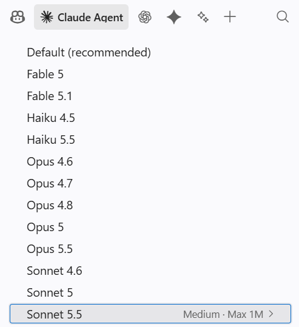
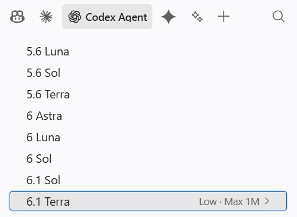
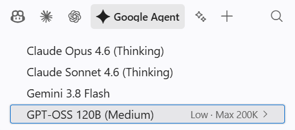
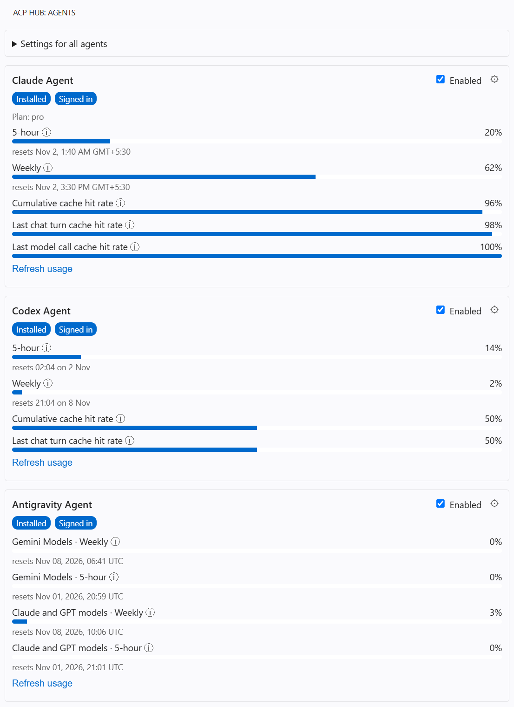

# ACP Hub for Copilot — Claude/Codex/Antigravity Agents via ACP Adapters

**Your AI plans. Your agents. GitHub Copilot Chat.**

Bring Claude Code, Codex, and Antigravity into VS Code's Copilot Chat. Sign in with your existing provider account, pick an available model, and get to work in the Copilot interface you already know. Uses the [Agent Client Protocol (ACP)](https://agentclientprotocol.com) to connect agents to Copilot Chat.

> ACP Hub for Copilot is an independent, unofficial extension. It is not affiliated with, endorsed by, or sponsored by Microsoft, GitHub, Anthropic, OpenAI, or Google. Claude, Codex, ChatGPT, Gemini, and Antigravity are trademarks of their respective owners and are used here only to identify the agents and services the extension works with.

  

## Why Agent Hub?

- **Use your existing plans.** Connect your Claude, ChatGPT, and Antigravity accounts and use available models through their respective agents. API key authentication is also available.
- **Stay in Copilot Chat.** Work with your chosen agent through VS Code's familiar chat interface and Copilot tools.
- **One place to manage agents.** Install, sign in, configure settings, and switch between agents from the ACP Hub sidebar.
- **See your usage.** Keep an eye on available plan limits and cache hit rates without leaving VS Code.

Agent Hub connects agents using the **Agent Client Protocol (ACP)**, the open protocol also used by editors such as Zed and JetBrains IDEs. It runs the providers' agents through ACP adapters and makes their models available in Copilot Chat.

## Get started

You'll need **VS Code 1.105 or later**, **GitHub Copilot Chat**, and access to at least one supported provider.

1. Open **Agent Hub** in the activity bar.
2. Select **Add agent**, then choose Claude, Codex, or Antigravity. Existing installations appear automatically.
3. Install the agent if needed, then sign in or add an API key from its card.
4. Open **Copilot Chat**, choose the agent's model from the model picker, and start chatting.

Available models, usage limits, and authentication options depend on your provider and plan. Removing an agent from the sidebar does not uninstall it. Saved API keys can be removed from the sidebar; browser account sign-out is managed by the agent's own account tools.

## Privacy and permissions

Agent Hub passes your chat requests to the selected local agent. Requests can include conversation history, workspace instructions, file contents, tool definitions and tool results supplied by Copilot Chat. The agent can send this information and credentials to its provider; the provider's terms and privacy policy apply ([Anthropic](https://www.anthropic.com/legal/privacy), [OpenAI](https://openai.com/policies/privacy-policy/), [Google](https://policies.google.com/privacy)). Review those policies and avoid sharing information you cannot send to the selected provider. Agent Hub also contacts services to install agents and retrieve available models or usage information. Third-party agents and adapters may make their own network requests or collect telemetry under their own policies.

API keys entered in Agent Hub are stored using VS Code's secret storage and passed to the selected agent when needed. Agent account credentials and their retention are managed by the agents. If request dumping is enabled for debugging, full prompts may be written as JSON files in the extension's local storage; keep this disabled unless needed and handle those files as sensitive. Logs can also contain diagnostic details.

**Permission requests raised by an ACP adapter agent itself are automatically approved by Agent Hub** when an allow option is offered. This applies only to the agent's own built-in tools, for example when you enable Antigravity's built-in file, shell and search tools; those run without a confirmation prompt. Tools provided by Copilot Chat are not affected: they always go through Copilot's normal confirmation flow. Review the agent's own configuration and use only agents and workspaces you trust.

Agent Hub is disabled in VS Code Restricted Mode and requires a trusted workspace.

## Settings and usage

Configure each agent from its card or search for `AgentHub` in VS Code Settings. The sidebar displays available plan limits and both last-turn and cumulative cache hit rates. Usage reporting varies by agent.

Want to use the agents with Copilot CLI? See the [gateway guide](docs/copilot-cli-gateway.md).

## Contributing

Run `npm ci`, then `npm run compile` and press **F5** to launch an Extension Development Host. Use `npm test` for unit tests and `npm run package` to create a VSIX.

Agent metadata lives in the [registry](registry/agents.json). After changing it, run `npm run generate` and `npm run generate:check`. Agents with custom behavior implement `AgentAdapter` in `src/adapters` and are registered in `src/core/agents.ts`. For details, see the [design](docs/superpowers/specs/2026-10-30-acp-hub-design.md) and [parity checklist](docs/parity-checklist.md).
