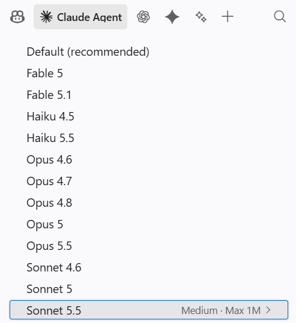
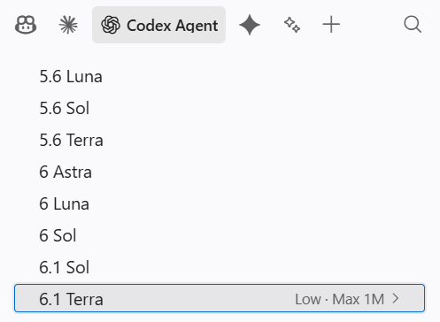
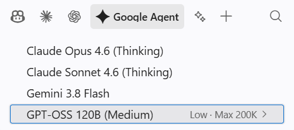
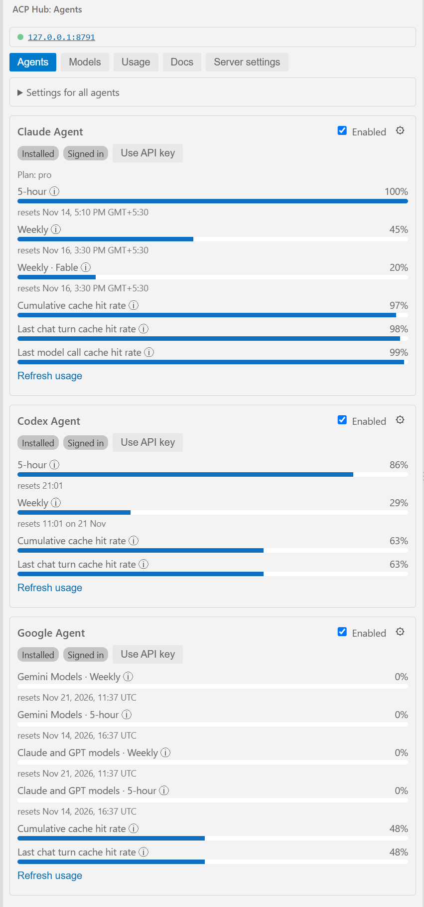

# ACP Hub — your AI plans as a local model server

**Your AI plans. Your agents. Any client.**

ACP Hub runs the agents of your existing Claude, ChatGPT/Codex and Antigravity plans behind a small local server and serves their models over an OpenAI-compatible API. Point GitHub Copilot CLI, VS Code's Copilot Chat, or any OpenAI-compatible client at it and work with the agent you already pay for. It talks to the agents over the [Agent Client Protocol (ACP)](https://agentclientprotocol.com), the same method IDEs such as Zed and JetBrains use to let you use other providers' agent plans inside the IDE.

> ACP Hub is an independent, unofficial project. It is not affiliated with, endorsed by, or sponsored by Microsoft, GitHub, Anthropic, OpenAI, or Google. Claude, Codex, ChatGPT, Gemini, and Antigravity are trademarks of their respective owners and are used here only to identify the agents and services the project works with.

  

## What it is

- **A local server** on `127.0.0.1` that runs the agents and keeps their sessions, settings, sign-ins and usage. The agents run on your machine and talk to their own providers.
- **An OpenAI-compatible API:** `GET /v1/models` (ids like `claude/sonnet`), `GET /v1/models/<id>` and streaming `POST /v1/chat/completions` with tool calls. The client runs its own tools, so its permission prompts still apply.
- **A control page** to install agents, sign in, change settings, watch plan limits and usage, and rename models.
- **An optional VS Code extension** that adds the models to Copilot Chat's picker and shows the control page in a sidebar.

Available models, limits and sign-in options depend on your provider and plan.

## Get started

You need **Node.js**, a checkout of this repository, and access to at least one supported provider.

1. `npm ci`, then `npm run compile`.
2. `npm run server`. It prints a link like `http://127.0.0.1:<port>/?token=<token>`.
3. Open the link once; a cookie keeps the control page signed in afterwards.
4. Install an agent and sign in or add an API key from its card. For Claude, **Sign in** opens a page that ends in a code; paste it into the card.
5. Point a client at the server (below).

## Using it from a client

### GitHub Copilot CLI

Run **ACP Hub: Sync Models** from the VS Code Command Palette, then restart the CLI. It writes the models, address and token to `~/.copilot/providers.json` (or `COPILOT_PROVIDERS_CONFIG`), keeping entries it did not write.

### Any OpenAI-compatible client

- **Base URL:** `http://127.0.0.1:8791/v1` (port set in **Server settings** or `ACP_HUB_PORT`).
- **Auth:** `Authorization: Bearer <token>`, from `~/.acp-hub/server.token` or `ACP_HUB_TOKEN`.
- **Model:** an id from `GET /v1/models`; `reasoning_effort` picks the thinking level.
- **Fields:** `tools`, `tool_choice`, `response_format` and `stream_options.include_usage` are honoured; sampling and length fields are ignored, and `n` above 1 is refused.
- **Chats:** send `x-chat-id` to keep a conversation in one agent session and `x-acp-cwd` to name its folder.

### VS Code

The optional extension needs **VS Code 1.105+** and **GitHub Copilot Chat**. It adds the models to the Copilot Chat picker and an **Agent Hub** sidebar with the control page.

- **Server.** A window attaches to a server already on the port, or starts the bundled one. All windows share one server, which keeps running after a window closes and shuts down after `acpHub.server.idleTimeoutMinutes` (default 30) unused. **ACP Hub: Stop Server** closes it at once. Logs are in the **ACP Hub Server** output channel.
- **Settings.** `acpHub.server.idleTimeoutMinutes`, `acpHub.server.detached` (run outside VS Code; default on) and `acpHub.server.autoStart` (default on). Agent settings live on the cards and in `~/.acp-hub/config.json`.
- **Renamed providers** show after **ACP Hub: Sync Models** and a window reload.
- **Restricted Mode** disables the extension, since it runs agent processes.

## Running the server

| Variable | Meaning | Default |
| --- | --- | --- |
| `ACP_HUB_PORT` | The port the server answers on, on `127.0.0.1`; it wins over the port saved in **Server settings** | the saved port, else `8791` |
| `ACP_HUB_TOKEN` | The bearer token clients send; otherwise the stored token is used, or made | `<root>/server.token` |
| `ACP_HUB_HOME` | The shared store: token, `config.json`, secrets, state and installed agents | `~/.acp-hub` |
| `ACP_HUB_PROMPTS_DIR` | Where the server reads its prompt files | built in |

- **Token.** Required on every API request. Any local process that can read the token file can use your plans, so protect the store folder like a credential.
- **Server settings** set the port; after changing it, run **ACP Hub: Sync Models** again.
- **Models** renames providers and models; **Refresh** asks the agents for their models again.
- **Usage** charts input, cache and output tokens per agent and workspace, kept for 30 days by default.
- **Docs** explains the server, the VS Code client and the Copilot CLI setup.

## Accounts

Claude and Codex can have more than one account (Windows only for now); Antigravity cannot.

- **Add** a named account under **+ Add account** in the card's ⚙; your existing one shows as **Default**.
- **Each account** has its own switch, sign-in or API key, and usage bars. The card's **Enabled** switch turns all of them off.
- **Ids.** Account `Work` on Claude is the agent `claude-work`, with models `claude-work/<model>` and the picker group `Claude Agent · Work`.
- **Reload** the VS Code window after adding or removing an account.
- **Remove account** deletes its login, API key, chats and folder.

## Settings and usage

Configure each agent from its card or in `~/.acp-hub/config.json`. The cards show plan limits, cache hit rates and cache misses where the agent reports them.

- **Replace the system prompt** (off by default): uses the client's guidance instead of the agent's built-in prompt.
- **Tool search** (Claude): loads tool descriptions only when needed, shrinking large requests.
- **Default thinking effort**: used when a request names none. Claude starts at High; Codex and Antigravity leave it to the agent.

## Privacy and permissions

Requests (conversation, file contents, tool definitions and results) go to the selected agent, which sends them to its provider under that provider's terms ([Anthropic](https://www.anthropic.com/legal/privacy), [OpenAI](https://openai.com/policies/privacy-policy/), [Google](https://policies.google.com/privacy)). ACP Hub also contacts services to install agents and read models and usage. Third-party agents may make their own network requests or collect telemetry.

API keys are stored in `~/.acp-hub/secrets.json`, readable by your account only. Agent sign-ins are managed by the agents. Logs can contain diagnostic details.

**ACP Hub automatically approves permission requests from an agent's own built-in tools**, which are off by default. Client tools are unaffected: the client's own confirmation flow decides. Use only agents and workspaces you trust.

## Contributing

`npm ci` and `npm run compile`, then `npm run server`, `npm test`, `npm run lint` and `npm run typecheck`. Press **F5** for an Extension Development Host; `npm run package` builds a VSIX.

Agent metadata lives in the [registry](registry/agents.json); run `npm run generate` after changing it. Custom agents implement `AgentAdapter` in `src/adapters`. See the [design](docs/superpowers/specs/2026-10-30-acp-hub-design.md) and the [parity checklist](docs/parity-checklist.md).

To release, bump the version in `package.json` and `package-lock.json`, rename the changelog's `Unreleased` section, run the [parity checklist](docs/parity-checklist.md), then `npx vsce publish` or the **Release** workflow (needs `VSCE_PAT`).